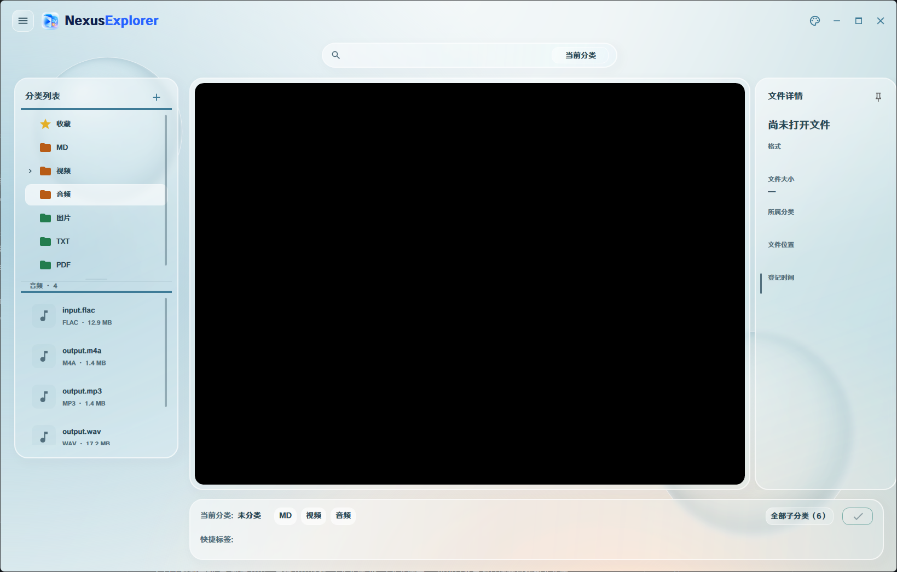
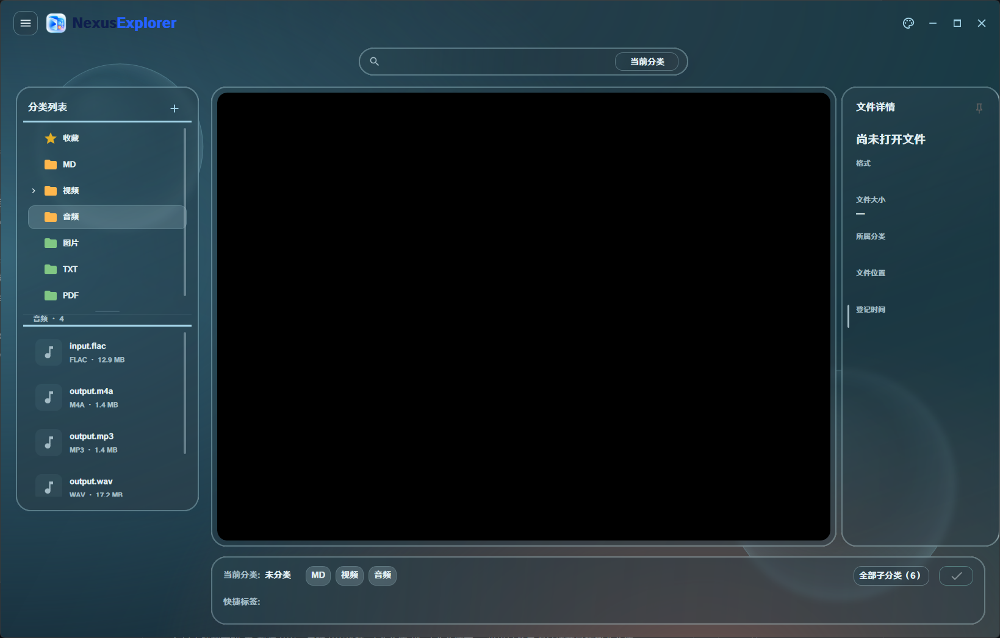

# NexusExplorer

一个 Windows 文件分类与预览工具。在同一个窗口里浏览视频、音频、图片和文档，边查看、边归类，再按需整理到磁盘目录。

[下载便携版或安装版](https://github.com/rasury/NexusExplorer/releases) · Windows 10 2004 及以上 / Windows 11 · x64

## 界面预览

浅色主题



深色主题



## 可以做什么

- **分类管理**：创建多级分类，拖动调整层级；批量归类、重命名、移除和删除文件。
- **一边看，一边整理**：播放视频和音频，查看静态图片、GIF、APNG、JFIF；预览 TXT、Markdown 和 PDF。Markdown 可切换排版与原文，PDF 支持翻页、跳页、缩放和连续滚动。
- **快速找到文件**：按文件名搜索当前分类或全部分类；文件列表显示格式、大小和可用封面，悬停查看缩略图。
- **收藏与快捷分类**：点击文件旁的星星收藏；常用分类可钉到底栏并拖动排序。
- **按需调整界面**：深色、浅色或跟随系统；自定义背景和透明度，调整左侧分类与文件列表的高度，展开或固定右侧文件详情。

## 怎么使用

### 1. 安装或直接运行

到 [Releases](https://github.com/rasury/NexusExplorer/releases) 下载：

- **Portable.zip**：完整解压到可写目录，运行 `NexusExplorer.exe`。不要只复制 EXE，它需要旁边的运行库。
- **Setup.exe**：按向导安装，可创建开始菜单和桌面快捷方式。默认安装到当前用户目录，无需安装 .NET SDK。

### 2. 导入与浏览

点击左侧“分类列表”旁的 **＋** 新建分类。右键分类选择“导入文件”或“导入文件夹”，也可以把资源管理器中的文件拖入分类。

**双击分类**打开文件列表，**双击文件**播放或预览。单击分类只选择操作目标。使用 Ctrl 多选、Shift 连续选择；拖动分类列表与文件列表之间的分隔条调整大小。

### 3. 归类与整理

把文件拖到目标分类，或在底栏选择目标后点击 **✓**。

**归类只改变软件内的归属，不搬动物理文件。** 需要真正移动文件时，右键分类选择“整理”：它会处理该分类及子分类，把文件移入各自的目录。遇到同名文件时按提示选择处理方式。

橙色文件夹表示待整理，绿色表示已整理。分类目录可通过右键菜单重新定位或迁移。

### 4. 播放、收藏和快捷操作

- 单击视频画面暂停 / 继续，双击画面切换全屏；下方控件可调节进度、音轨及硬件解码。
- 悬停喇叭展开音量条，点击喇叭静音 / 恢复音量。
- 悬停文件，点击右侧星星收藏；金色表示已收藏。收藏不会复制物理文件，从原分类“移除”后仍保留收藏。
- 右键分类“钉到底栏”，通过快捷标签快速归类；标签支持拖动排序、Ctrl / Shift 多选及批量取消钉住。
- 悬停窗口右侧把手查看文件详情，点击图钉可保持展开。右上角调色盘打开外观设置。

### 5. 移除、删除与备份

**移除只取消登记，保留物理文件；删除会将相应物理文件送入回收站。** 在收藏中删除物理文件，也会影响它在原分类中的记录。

默认数据位于程序旁的 `data/`、`Storage/`，配置为 `appsettings.json`；也可使用配置指定的位置。迁移或备份时，请关闭软件，保留数据库、配置及实际文件，不要只备份 EXE。

安装版升级保留配置和运行数据；卸载保留用户文件和数据库。便携版更新前先备份，再替换程序文件，保留已有的 `data/`、`Storage/`、配置和缓存。

## 项目仓库

基于 **WPF / .NET 8**，使用 SQLite 管理数据、libmpv 播放媒体，MdXaml 预览 Markdown，Windows PDF API 渲染 PDF。

- [src/NexusExplorer](src/NexusExplorer)：应用源码。
- [tests](tests)：相关功能与发布流程检查。
- [scripts](scripts)：依赖还原、便携包、安装包和 Release 发布脚本。

## 构建与发布

开发需要 Windows x64、.NET 8 SDK；打包需要 Python 3.10+。首次构建会下载并校验固定版本的 mpv 依赖。

```powershell
dotnet build NexusExplorer.sln -c Release
# 日常本地打包：保留固定目录中的用户数据，不发布 GitHub Release
.\scripts\Update-Preview.ps1
# 明确发布时运行：构建便携包和安装包，上传后发布 GitHub Release
.\scripts\Publish-Release.ps1
```

发布前将项目版本号更新为未发布的版本并提交、推送；脚本拒绝未提交的受跟踪改动及重复版本。GitHub 身份使用 `GH_TOKEN`、GitHub CLI 登录状态，或本机已有的 Git 凭据。构建工具自动从固定官方版本下载并校验。

也可在 GitHub **Actions → Publish release → Run workflow** 手动发布。普通提交不会触发 Release。每次发布包含便携 ZIP、EXE 安装包和 SHA256 校验文件；先上传到草稿，附件齐全后才公开。

本地固定产物是 `artifacts/NexusExplorer_new.zip` 和 `artifacts/NexusExplorer_new/`，正式发布附件在 `artifacts/releases/`。只运行本次修改相关的测试，不要求每次执行全套测试。

## 许可

本项目采用 GPL-2.0-or-later，见 [LICENSE](LICENSE)。发行包附对应项目源码及原生组件许可、构建和源码获取说明。原生构建的 client API 头文件许可不替代完整 core 和依赖的许可，详见 [SOURCE.txt](licenses/SOURCE.txt)。
